<p align="center">
  
</p>

# Blackwall

This is a mere project and not a complete secure proof Antivirus


### Human-authorized control for files, processes, and AI-driven automation

**A concept for a Windows security product and soon Linux that helps prevent AI agents,
scripts, and unauthorized applications from making changes without
explicit approval.**


> **Project status:** This repository describes a product concept and
> proposed architecture. It is not a working antivirus, kernel driver,
> or security guarantee.

## Desktop client preview

The Windows client (WPF, .NET 10) and its **protection engine** work on
real data: protected folders, your rules, approvals, the activity log,
saved versions with **Undo**, the **process watcher** (live process tree,
launch chains with each program's own icon and AI-agent names,
signatures, Task Manager-style CPU, memory and End task), **Hidden files**
and the **quarantine vault**. The engine runs in the **Blackwall
service**, which sees which program made each change, or inside the app
when the service isn't installed. Without the Phase 3 kernel driver it
can't hold a change back: it sees it right after it happens, asks you,
and puts the previous version back if you say no. Microsoft Defender
checks what AI agents and downloaded programs run, a program that
scrambles many files is stopped and its changes undone, and the Network
page shows which programs are online. Sample data is still available with
`Blackwall.exe --demo`. Closed, Blackwall keeps running in
the notification area and raises Windows notifications for changes. New
versions are published as GitHub Releases: Blackwall finds them, shows what
changed, and installs one when you click Install, after checking its
checksum. Changes are listed in [`CHANGELOG.md`](CHANGELOG.md).

### Install

Blackwall is free to use; the source code is not public. It needs Windows
10 or 11 (64-bit) and the [.NET 10 Desktop
Runtime](https://dotnet.microsoft.com/download/dotnet/10.0).

1. Download `Blackwall-<version>-win-x64.zip` and its `.sha256` from
   [Releases](https://github.com/DistressedBrain/Blackwall/releases), and
   check they match: `(Get-FileHash .\Blackwall-<version>-win-x64.zip).Hash`.
2. Unpack it to `C:\Program Files\Blackwall` (as administrator).
3. In an administrator PowerShell, install and start the service:
   `& "C:\Program Files\Blackwall\Blackwall.Service.exe" install`
4. Start `Blackwall.exe` from the Start menu or Explorer. The sidebar should
   say **Service connected**.

To remove it: `& "C:\Program Files\Blackwall\Blackwall.Service.exe" uninstall`,
then delete the folder and `C:\ProgramData\Blackwall`. Without the service,
`Blackwall.exe` still protects your folders from inside the app, but can't
tell which program made a change.

<p align="center">
  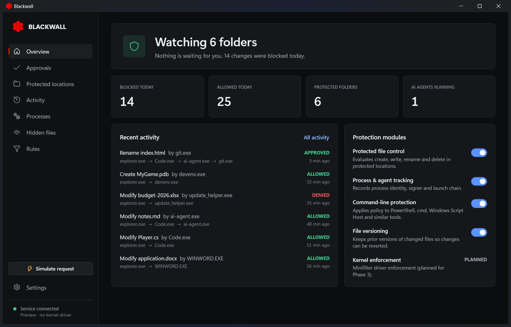
</p>

**Security status** sums it up: a security score out of 100 with what
raises and lowers it, threats over time, threats by type and how they
ended. Every warning is labelled **AI agent**, **Virus**, **Malware**,
**Hacker** or **Suspicious**, with the reason, in Activity, Approvals, the
prompt and notifications.

<p align="center">
  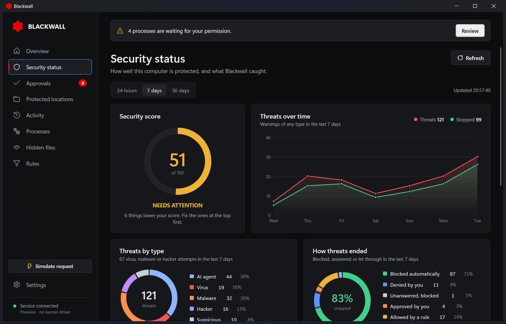
</p>

When a program that isn't trusted (an AI agent, or anything unsigned)
changes something you protect, Blackwall shows who did it, what changed
(with the changed lines of a text file) and the full launch chain. Allow
keeps the change. Deny, or no answer in time, puts the previous version
back. Once the kernel driver exists, the change will wait for your answer
instead of being undone.

<p align="center">
  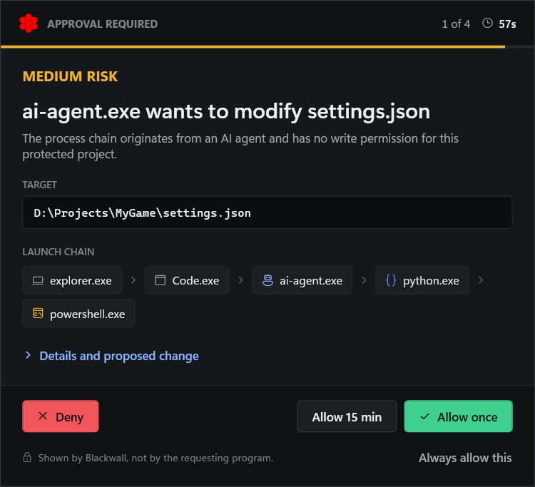
</p>

| Approvals | Activity |
|---|---|
| 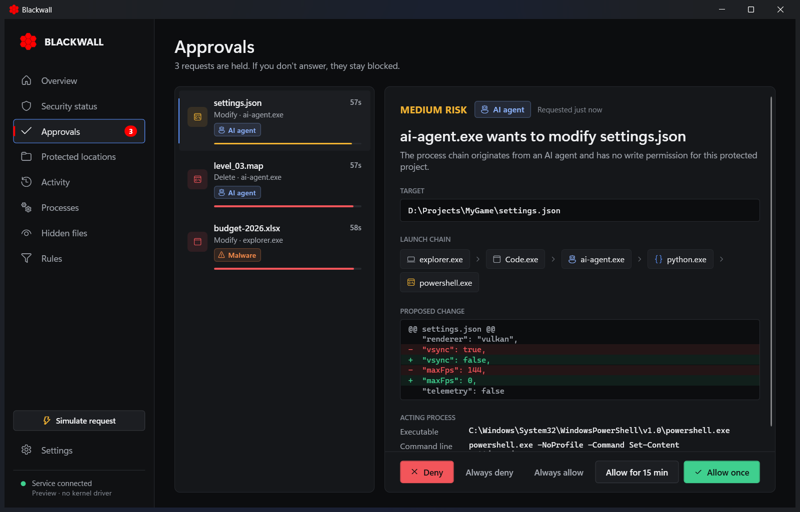 | 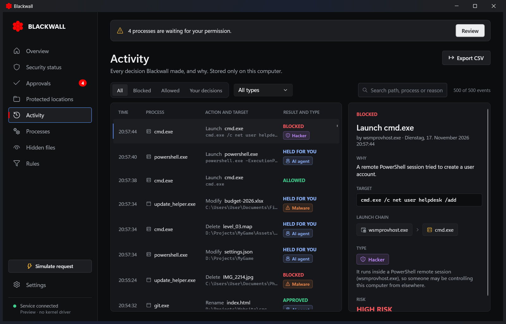 |
| **Processes** (live) | **Hidden files** (live) |
| 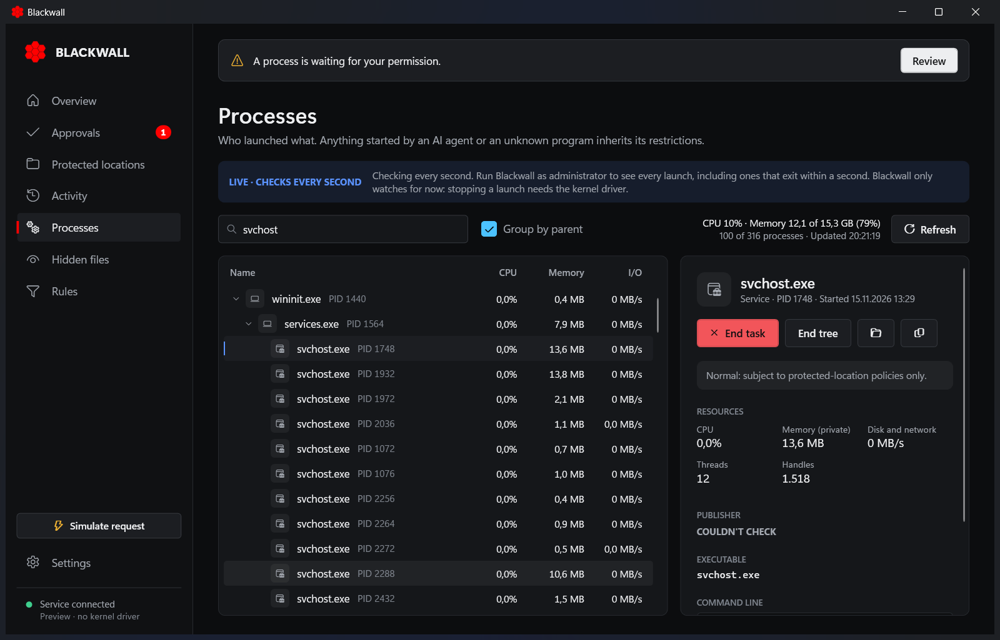 | 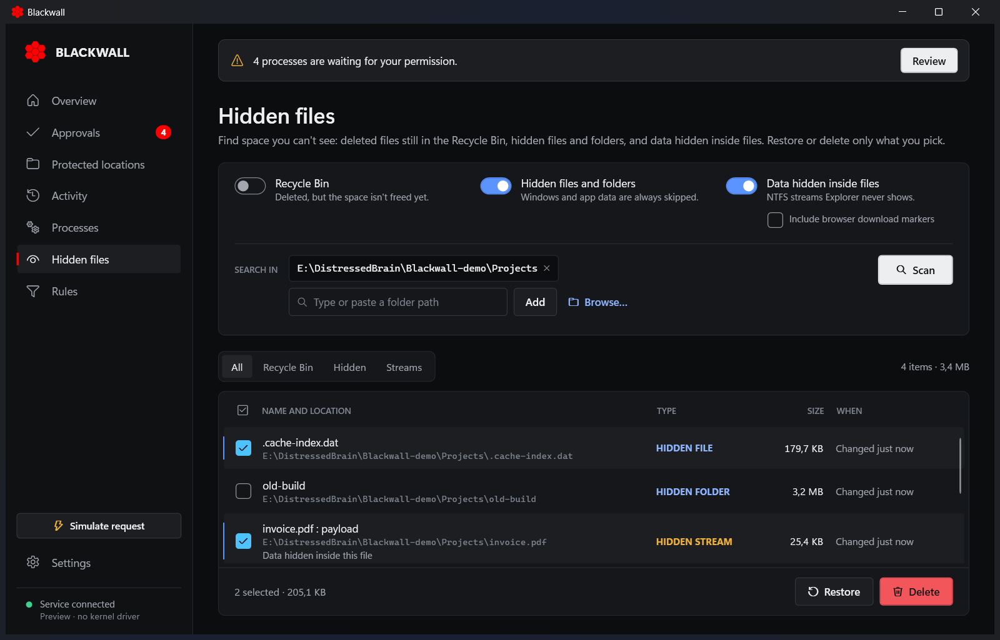 |
| **Protected locations** | **Kernel** |
| 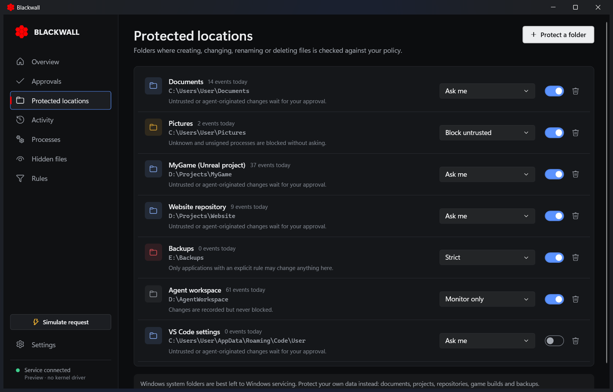 | 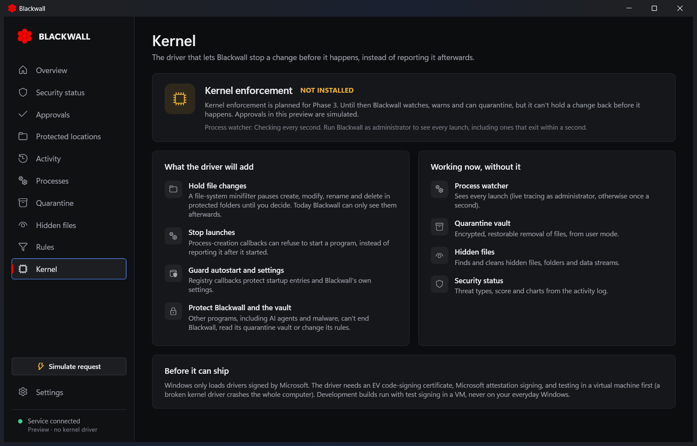 |

**Quarantine** keeps removed files in a quantum-locked vault: AES-256-GCM,
with each file's key from ML-KEM-768 (post-quantum) and the vault key
sealed to your Windows account. Every item has its full history (why it was
removed, the launch chain as a tree, each step) and can be restored for 30
days. **Automatic removal** of viruses and malware is off by default; when
you turn it on (after a warning) it ends the program and moves its file into
the vault, never deleting on the spot. Rules can be added on the Rules page
or straight from an Activity event.

<p align="center">
  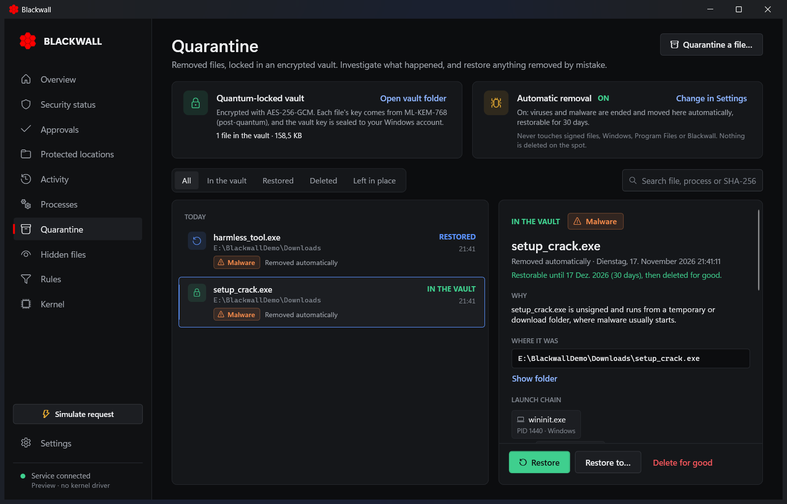
</p>
<p align="center">
  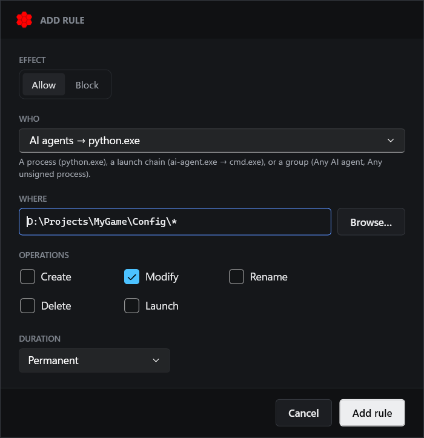
</p>

------------------------------------------------------------------------

## Overview

Blackwall is a proposed Windows endpoint-protection system built
around a simple principle:

> **A process should not be allowed to make sensitive changes just
> because it has the technical ability to do so.**

Traditional antivirus products primarily look for malicious files, known
signatures, suspicious code, and harmful behaviour. Blackwall adds
another layer: **who is requesting an action, what are they trying to
change, and has the user authorized it?**

The concept is intended to help protect against:

-   AI agents modifying files or projects without permission.
-   Scripts and child processes launched by an agent.
-   Unauthorized PowerShell, Command Prompt, and other command-line
    activity.
-   Unexpected changes to important folders and configuration files.
-   Malware and ransomware attempting to alter protected data.
-   The user's own unawareness when using AI agents from uknown origins

Blackwall is not intended to replace antivirus software yet. It is a
proposed **antivirus with authorization and activity-control layer** that could
complement existing endpoint security.

## Core principles

1.  **Human authority:** sensitive actions require approval from the
    user or an explicit policy.
2.  **Default-deny for protected resources:** unknown or unauthorized
    processes do not automatically receive write access.
3.  **Process accountability:** evaluate the process requesting an
    action and its launch chain, not just its filename.
4.  **Least privilege:** grant only the permissions needed, for only as
    long as needed.
5.  **Visibility:** explain what was requested, by which process, and
    why it was allowed or blocked.
6.  **Recoverability:** preserve versions or backups so approved and
    unapproved changes can be reviewed and reversed where possible.

## How it could work

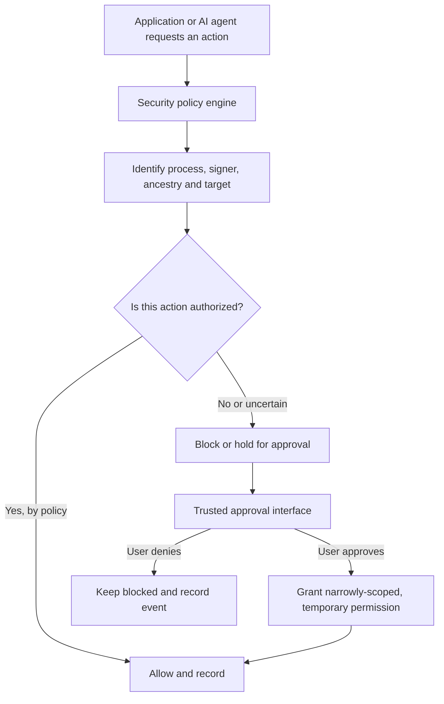

The enforcement layer should make the final decision. The user interface
should not be able to silently grant itself permissions, and an AI agent
should not be able to approve its own request.

## Proposed protection modules

### 1. Protected file control

Users can mark folders or files as protected, for example:

-   Windows system locations.
-   Documents and personal files.
-   Game-development projects.
-   Source-code repositories.
-   Configuration and application data.
-   Backups and recovery locations.

For protected locations, Blackwall could evaluate file creation,
writing, replacement, renaming, and deletion. A policy could allow
trusted applications, deny unknown processes, or require a user
decision.

### 2. AI-agent and process tracking

The system should not rely only on a list of AI application names. An
agent can launch PowerShell, Python, Command Prompt, or another helper
process.

A stronger design records process identity and relationships, including:

-   Executable path and cryptographic hash.
-   Digital signature and publisher, when available.
-   Process ID and parent/creator relationships.
-   Command-line information, subject to privacy controls.
-   User identity, integrity level, and security context.
-   Whether the process is part of a known agent workflow.

Process ancestry is useful evidence, but it is not perfect proof of who
initiated an action. Process relationships can be obscured by brokers,
services, scheduled tasks, and other legitimate Windows mechanisms.

### 3. Human-intent verification

A person opening PowerShell from Windows Search is different from an
agent silently launching PowerShell --- but the launch method alone is
not trustworthy proof of human intent.

Blackwall could combine signals such as:

-   A trusted, visible approval action.
-   Windows process and security metadata.
-   The requesting process and its ancestry.
-   A short-lived authorization token bound to a specific process and
    action.
-   The exact command or file operation being requested.

**Important:** simulated mouse and keyboard input can imitate ordinary
UI interactions. Therefore, typing an application name into Search
should be treated as a useful signal, not as a security boundary.
High-risk actions should require approval through a separate trusted
interface.

### 4. Command-line protection

PowerShell, Command Prompt, Windows Script Host, and other execution
tools could be subject to policy.

Example policy:

  -----------------------------------------------------------------------
  Situation                           Proposed decision
  ----------------------------------- -----------------------------------
  User explicitly approves a specific Allow that session
  PowerShell session                  

  AI agent launches PowerShell        Block or request approval
  unexpectedly                        

  Agent launches Python, which        Evaluate the full process chain
  launches PowerShell                 

  A trusted administrator tool runs   Allow according to policy
  an approved task                    

  Unknown process attempts a          Block or request approval
  protected-file write                
  -----------------------------------------------------------------------

A manually opened terminal should not become a blanket permission for
every process. Permissions should be scoped to the session, command,
target, and duration.

### 5. Approval and change review

An approval prompt could show:

-   Requesting application and process chain.
-   Target file or folder.
-   Requested operation.
-   Proposed content changes or a diff, where available.
-   Risk explanation and policy reason.
-   Options to allow once, deny, or create a narrowly scoped rule.

Example interaction:

``` text
Blackwall — APPROVAL REQUIRED

Requesting process:
AI Agent → Python → PowerShell

Requested action:
Modify: D:\Projects\MyGame\settings.json

Reason:
The process does not have write permission for this protected file.

[ Allow this change ]  [ Deny ]
```

The prompt should be displayed by a trusted user-mode component, not by
the requesting agent.

### 6. Audit log and recovery

Record security-relevant events in a tamper-resistant log where
practical:

-   Process creation and identity evidence.
-   File operations that were blocked or allowed.
-   Approval decisions and the scope of each grant.
-   Policy changes.
-   Driver and service health events.

For important files, versioning or snapshots can make recovery easier. A
log alone is not a backup, and rollback is not always safe or possible.

## Proposed Windows architecture

A possible Windows implementation would use a small kernel component for
enforcement and a user-mode service for policy, interface, and event
management.

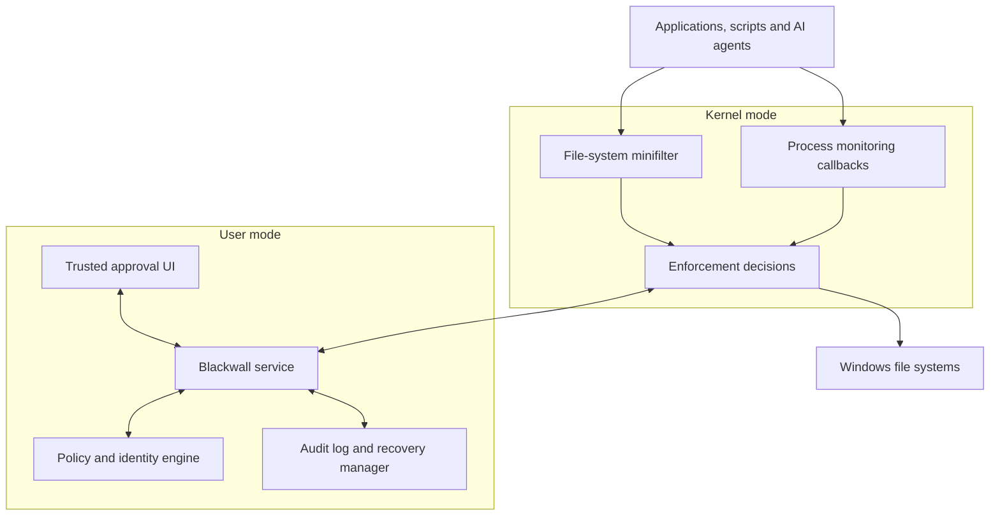

Potential Windows technologies to investigate:

-   **File System Minifilter Drivers:** intercept selected file-system
    operations through Filter Manager.
-   **Process creation notifications:** observe process creation and
    collect process metadata.
-   **Windows Event Tracing (ETW):** collect useful diagnostic and
    security telemetry.
-   **Windows security descriptors and access controls:** use native
    authorization mechanisms where appropriate.
-   **Code signing and driver signing:** establish publisher identity
    and meet Windows driver requirements.

References:

-   [Microsoft: File System Minifilter
    Drivers](https://learn.microsoft.com/en-us/windows-hardware/drivers/ifs/file-system-minifilter-drivers)
-   [Microsoft: Filter Manager
    Concepts](https://learn.microsoft.com/en-us/windows-hardware/drivers/ifs/filter-manager-concepts)
-   [Microsoft:
    PsSetCreateProcessNotifyRoutineEx](https://learn.microsoft.com/en-us/windows-hardware/drivers/ddi/ntddk/nf-ntddk-pssetcreateprocessnotifyroutineex)
-   [Microsoft: Windows Driver Kit
    (WDK)](https://learn.microsoft.com/en-us/windows-hardware/drivers/download-the-wdk)

The kernel component should remain as small as possible. Complex policy
decisions, user prompts, and slow operations should be handled in user
mode. A kernel driver must never wait indefinitely for a user response.

## Security considerations and limitations

Kernel-level enforcement is powerful, but it increases the consequences
of implementation mistakes.

-   **Process identity is not intent:** parent-process information helps
    with attribution but does not conclusively identify a human or an
    AI.
-   **Multiple ways to modify files:** account for writes, memory-mapped
    I/O, rename-and-replace patterns, deletion, hard links, and other
    filesystem behaviours.
-   **Existing handles:** a process may already have an open handle when
    a policy changes. The design must account for access checks at the
    right points.
-   **Services and brokers:** legitimate applications often delegate
    work to Windows services or helper processes. Overly simple ancestry
    rules can break normal software.
-   **Kernel reliability:** driver bugs can cause crashes or data loss.
    Test in virtual machines and use supported Windows driver
    interfaces.
-   **Tamper resistance:** an administrator or kernel-level attacker may
    be able to disable or interfere with protection. Do not promise
    absolute protection.
-   **Recovery:** blocking a write does not undo earlier damage. Backups
    and tested recovery procedures remain essential.
-   **Privacy:** process command lines, file paths, and audit logs may
    contain sensitive information. Keep collection local by default and
    provide clear retention controls.

Blackwall should be developed and tested alongside Microsoft Defender
and other security controls, not by disabling them.

## Development roadmap

### Phase 1 --- User-mode prototype

-   Build a Windows service and desktop interface.
-   Monitor file and process events using supported Windows facilities.
-   Create protected-folder policies.
-   Demonstrate allow, deny, and approval workflows.
-   Log decisions and explain why they happened.

**Status:** built. There's a Windows service and the app. File changes in
protected folders come from Windows' change notifications and, in the
service, from live file tracing that says which program made each one.
Process starts are watched too. Allow, deny, approval and Undo all work
(an unapproved change is undone, since user mode can't hold it), and
every decision is logged with its reason.

### Phase 2 --- Policy and identity engine

-   Track process ancestry and executable identity.
-   Add rules for terminals, scripting engines, and agent workflows.
-   Add temporary, narrowly scoped permissions.
-   Test legitimate developer tools and common application workflows.

**Status:** mostly built. Launch chains, SHA-256 and signatures; rules by
program, chain (`AI agents → powershell.exe`), publisher, signature, folder
pattern or command line; and rules for 15 minutes or until restart, from
the editor or straight from an approval. Testing with real developer tools
still needs the service running with live file tracing (administrator)
over everyday work.

### Phase 3 --- Kernel enforcement

-   Research and implement a Windows minifilter driver.
-   Enforce protected-file policies in the kernel.
-   Keep policy evaluation and UI interaction in user mode.
-   Test failure handling, performance, signing, installation, and
    removal.
-   With the driver: **real-time scanning** (on open and run), **stopping
    launches** before they start, **tamper protection** for Blackwall and
    its vault, **rootkit and boot checks**, and **network filtering** in
    the kernel (a Windows Filtering Platform callout, the way Portmaster
    does it).

### Phase 4 --- Advanced protection

Done in user mode first, in this order:

1.  **Malware scanning through Microsoft Defender** (built). Windows' scanning
    interface (AMSI) checks unsigned programs from Downloads and Temp, and
    the scripts and commands AI agents run, against Defender's signatures,
    without a signature database of our own.
2.  **Ransomware detection** (built). A program that rewrites many protected
    files quickly with random-looking content, or touches trap files, is
    stopped and all of its changes are undone from the saved versions.
3.  **Network monitor** (built, except DNS names and asking before a
    first connection, which need live network tracing). Which programs and AI agents connect where (with
    the DNS name), live and as history; a per-program "block internet"
    through the Windows Firewall; ask when an AI agent or an unknown
    program goes online for the first time. Ideas from
    [Portmaster](https://github.com/safing/portmaster) (GPL-3.0, ideas
    only, no code).
4.  **Scans** (built). "Scan this folder" and scheduled scans of Downloads,
    startup entries and protected folders.
5.  **USB and removable drives:** scan when plugged in, optional "ask
    before running programs from a USB drive".
6.  **Sandboxed first run:** start an unknown program in Windows Sandbox
    instead of on the real system.
7.  **File reputation (opt-in):** look up a file's hash with a public
    malware database. Off by default, because it sends the hash out.
8.  **Web and download protection:** dangerous-site and phishing lists
    for downloads, via DNS filtering.
9.  Change previews and file versioning (done), delegated-execution
    detection, policy protection.

### Phase 5 --- Extras

-   Secure DNS (DNS over HTTPS) and tracker blocking.
-   VPN, password manager, parental controls.
-   PC clean-up (beyond Hidden files) and start-up manager.
-   Email attachment scanning.

## What we've learned so far

From studying open-source protection projects (details and vetting in
[`docs/backend-research.md`](docs/backend-research.md)). Blackwall's code is
written from scratch; these projects are used for ideas only.

| # | Lesson | What it means for Blackwall |
|---|---|---|
| 1 | **User mode can watch, not stop** | Windows event tracing (ETW) sees file and process activity but cannot pause or block it. Real "hold for approval" needs the Phase 3 minifilter; until then Phase 1 can only alert and restore. |
| 2 | **ETW is the Phase 1 sensor** | The kernel process provider gives process ID, parent ID, image path and start time, which is enough to build the launch chain. The command line isn't in the event; it's read from the new process right away. The kernel file provider reports file operations on protected folders. |
| 3 | **Track process families, not single processes** | Give a process and everything it launches one shared group ID. Then "AI agent → Python → PowerShell" is treated as one actor. |
| 4 | **A process name proves nothing** | Identity has to be the file's SHA-256 hash plus its Authenticode signer. Parent IDs can also be faked, so ancestry is evidence, not proof. |
| 5 | **Kernel decides *when*, user mode decides *what*** | In a minifilter, the driver only catches the operation and asks the service over a communication port. The service makes the decision, and the driver uses a timeout so it never waits forever. |
| 6 | **Ransomware leaves a pattern** | Bursts of high-entropy writes, rename-and-replace of many files, and touched "trap" files are strong signals. They can catch threats that no rule names. |
| 7 | **Rules should be readable data** | Behaviour rules kept in plain files (as in Sigma and Fibratus) can be reviewed, updated and explained. That fits the "explain why it was allowed or blocked" principle. |
| 8 | **File scanning comes later** | A pattern engine such as YARA-X fits Phase 4. ClamAV could only run as a separate program because of its licence. |
| 9 | **Isolation is an alternative to blocking** | Sandboxie shows that untrusted tools can be run in a sandbox, where their changes stay contained, instead of being refused outright. |
| 10 | **Vet before trusting** | None of the checked projects hid malware, but several ship real malicious test samples and suggest `irm … \| iex` installs. Always check SHA-256 and signatures, and test in a VM. |
| 11 | **Licences decide what we can reuse** | Blackwall is closed-source freeware, so only permissive code (MIT, BSD, Apache-2.0) may go in, with its notice shipped in `THIRD-PARTY-NOTICES.txt`. GPL, AGPL and MS-PL code can't be mixed in, and "source-available" licences (OpenEDR, Elastic) are out. A GPL tool such as ClamAV could only run as a separate program. |
| 12 | **We build our own** | Blackwall is written from scratch on documented Windows APIs. The projects above are only for learning. |
| 13 | **Live tracing needs admin rights** | Starting an ETW session needs administrator rights. Without them the process watcher checks once a second, which can miss processes that exit within that second. |
| 14 | **Windows reuses process IDs** | A parent ID alone can point at the wrong, newer process. A parent only counts if it started before its child and was still running when the child started. |
| 15 | **Most Windows files are catalog-signed** | `cmd.exe` and `explorer.exe` have no signature inside the file. Their signature lives in a Windows catalog, so a check that only looks inside the file wrongly calls them unsigned. |
| 16 | **One app is many processes** | The Claude desktop app runs as about a dozen `claude.exe` processes. Count an agent once, at the top of its own process family. |
| 17 | **Protection has to outlive the window** | Closing the app mustn't stop the watching. Blackwall stays in the notification area and alerts with Windows notifications; later the Windows service takes over the watching. |
| 18 | **A prompt must not steal the keyboard** | Our approval prompt took keyboard focus when it appeared, so keys meant for another app could reach a focused Allow button. Now it doesn't take focus, and Allow only responds to a click. |
| 19 | **Check the start time before ending a process** | A process ID can belong to a new process by the time you click End task. Blackwall ends a process only if its start time still matches the one on screen, asks first, and refuses processes Windows can't run without. |
| 20 | **Label threats by behaviour, and say why** | Without a signature database, "virus" or "hacker" has to come from what a process does: changing other programs, running from Downloads, hidden commands, remote sessions. Each label carries its reason so the user can judge it, and it never replaces a real virus scan. |
| 21 | **Count a threat once** | A held request is logged when it's raised and again when it's answered. Charts count the first sighting as the threat and the answer as its outcome, or every held request would count twice. |
| 22 | **Judge a command by who runs it** | Some tools and agents start PowerShell with an encoded command line. Flagging everything below such a process as malware would have quarantined ordinary programs an agent started. Only the acting process's own command counts. |
| 23 | **Automatic removal must be reversible** | Behaviour-based labels can be wrong, so "remove" means: end the program, encrypt the file into the vault, check the copy, then delete the original. Restoring a file marks it trusted, or it would be taken again on its next run. |
| 24 | **Without the driver, "deny" means "undo"** | User mode only hears about a change after it happened. So the engine keeps each protected file's last approved version first, and Deny, a timeout or a block rule puts it back. Several changes by one program within a few seconds go into one question, so an agent editing 30 files doesn't raise 30 prompts. |
| 25 | **Check who's asking, and fail closed** | Any program can connect to the service's pipe, AI agents included. Only the trusted Blackwall app may change protection or answer approvals, and only if its whole launch chain traces back to Windows with no agent in it. A first version waited for nothing: a window an agent had just started looked agent-free for a second, so it got full rights. |
| 26 | **Never do a user's file work as SYSTEM** | The service runs as SYSTEM, which may write anywhere. Restoring a file with those rights would let anyone who protects a folder swap it for a link and write into Windows. The service acts as the folder's owner instead. |
| 27 | **Ignore only your own echo** | Putting a file back makes Windows report a change. Ignoring every change to that file for a few seconds let a real change slip through in tests. Now a change that only matches the saved version is dropped; anything else is judged. |
| 28 | **The updater is an attack path too** | The part that installs runs as administrator, so it trusts nothing the normal app hands it but a version number. It fetches the release, the checksum and the package itself, into a folder only administrators can write, so nothing can swap the file between the check and the install. If the new version doesn't start, the old one is put back. |

## Suggested initial technology stack

  Component                     Candidate technology
  ----------------------------- -------------------------------------------
  Kernel file enforcement       C / Windows Driver Kit
  User-mode service             C++ or C#
  Desktop interface             WinUI 3 or WPF
  Process and event telemetry   Windows APIs / ETW
  Policy storage                SQLite or protected local configuration
  File integrity                SHA-256
  Testing                       Windows virtual machines and test signing

These are candidate technologies, not final implementation decisions.

## Example policy philosophy

  -----------------------------------------------------------------------
  Resource                            Default policy
  ----------------------------------- -----------------------------------
  Personal documents                  Require approval for untrusted
                                      writers

  Source-code projects                Require approval for
                                      agent-originated changes

  Windows system files                Strict protection; rely on Windows
                                      servicing mechanisms

  Temporary workspace                 Allow selected agent operations

  Trusted applications                Explicit, limited permissions

  Unknown executables                 Restrict access to protected
                                      resources
  -----------------------------------------------------------------------

The goal is not to interrupt every normal computer operation. It is to
make sensitive actions visible, attributable, and controllable.

## Project goals

-   [ ] Prevent unauthorized modifications to protected files.
-   [ ] Attribute actions to processes and their launch chains.
-   [ ] Detect AI-agent workflows and delegated execution.
-   [ ] Require explicit approval for sensitive actions.
-   [ ] Provide temporary, scoped authorization.
-   [ ] Maintain useful audit logs.
-   [ ] Support recovery and file-version comparison.
-   [ ] Keep kernel-mode code small and reliable.
-   [ ] Coexist with existing antivirus and Windows security features.

## Disclaimer

Blackwall is a proposed security concept. The architecture and
features described here are exploratory and require engineering, threat
modeling, testing, and security review before they can be relied upon. A
prototype must not be presented as production-grade antivirus
protection.

## Licence

Blackwall is **freeware**: free to use at home and at work, all rights
reserved. You may not sell, redistribute, modify or reverse-engineer it.
It comes without any warranty. See [`LICENSE`](LICENSE) for the terms and
[`THIRD-PARTY-NOTICES.txt`](THIRD-PARTY-NOTICES.txt) for the components it
includes. Source code that was published in this repository before
version 0.2.0, under the GPL-3.0, keeps that licence.

------------------------------------------------------------------------


**Blackwall --- Your computer. Your files. Your permission.**

